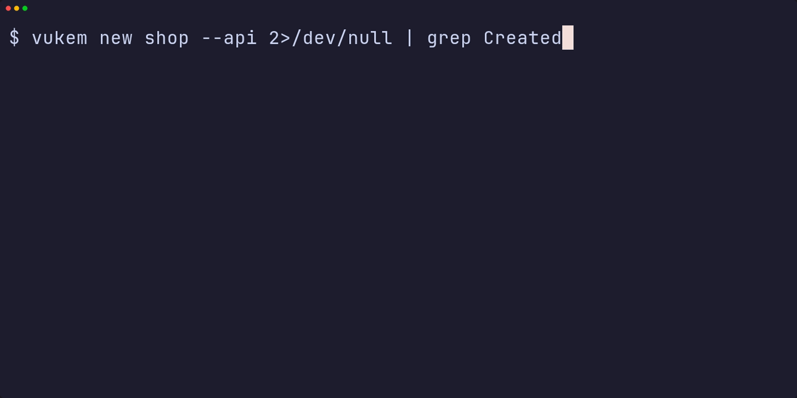
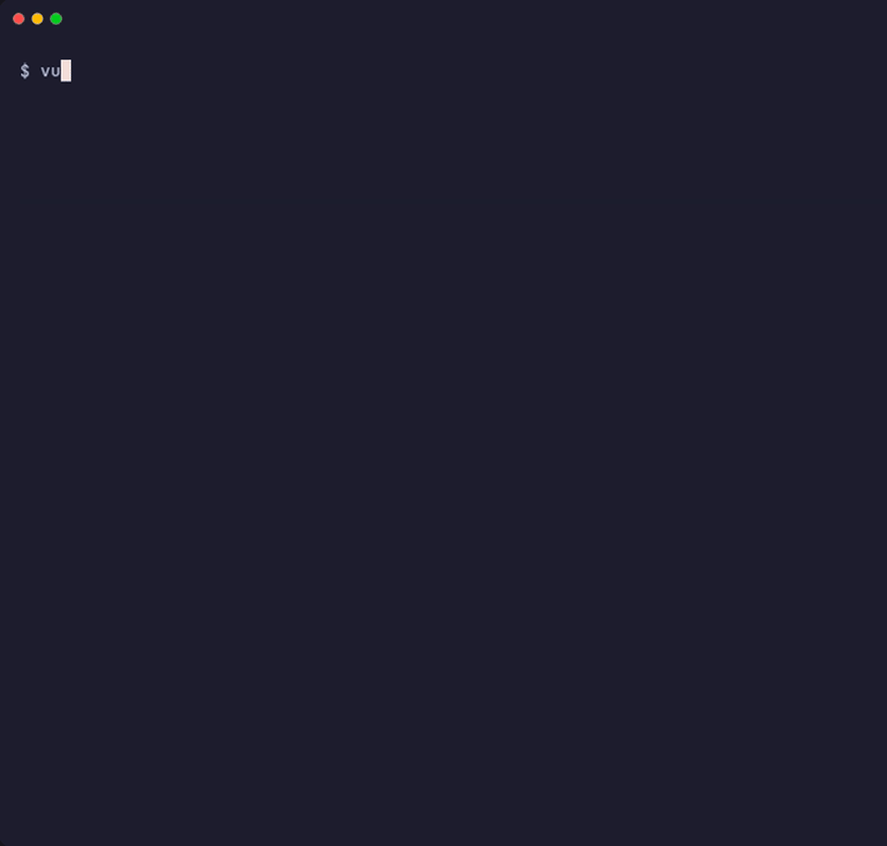

<div align="center">
  <br/>

  <a href="https://vukem.dev"></a>

  <br/>

  <a href="https://github.com/AlexGalhardo/vukem/actions/workflows/ci.yml"></a>
  <a href="https://app.codecov.io/gh/AlexGalhardo/vukem"></a>
  <a href="https://github.com/AlexGalhardo/vukem/actions/workflows/release.yml"></a>
  <a href="https://github.com/AlexGalhardo/vukem/releases"></a>
  [](go.mod)
  <a href="LICENSE"></a>
  <a href="https://scorecard.dev/viewer/?uri=github.com/AlexGalhardo/vukem"></a>

  <br/>

  <h3><strong>Vukem is a complete Model-View-Controller (MVC) web framework for Go built on <span style="color: orange">net/http</span> and the <span style="color: orange">standard library</span> to build APIs and FullStack Web Applications.</strong></h3>

</div>

<br/>

## Summary

Vukem gives Go developers the productivity of Laravel and AdonisJS without leaving `net/http`: routing, validation, an SQL-first ORM, auth, queues, real time and a CLI that writes code you own, in one framework that stays plain Go.

| Area | What you get |
| --- | --- |
| **HTTP** | `net/http`-native router with named routes, resources, groups and host-only groups (`Group.Only`); middleware is `func(http.Handler) http.Handler` and its default order is fixed by a test; request-log attributes (`web.AddLogAttrs`, matched route); `route:list` with method, path and name filters; HTTP/3 (`contrib/http3`). |
| **Validation** | Zod-style typed schemas (`z`) for every input, including files: generic `Slice`/`Map`, unions and discriminated unions, literals, tuples, recursive schemas (`Lazy`), `Pick`/`Omit`/`Partial`/`Extend`, string formats, codecs and brands, cross-field rules and issues with stable codes; exportable as JSON Schema, TypeScript and Zod. |
| **Database** | SQLite built in, PostgreSQL and MySQL/MariaDB driver modules, MongoDB, and an experimental Turso driver (a local file synced with Turso Cloud); an SQL-first ORM with a generic query builder, relations, joins, aggregates, subqueries, upsert, typed raw SQL, `UpdateOnly`, `OrWhere*`, dialect capabilities and conflict errors (409), typed column references (`codegen:models`), savepoints and optimistic locking (`orm:"version"`); encrypted columns, factories and seeders; migrations with SQLite table rebuilds, `Column.Change`, schema inspection (`schema.Inspect`), `migrate:check`, `migrate:diff` and `db:pull`. |
| **Auth** | Sessions, API tokens, JWT with JWKS and refresh tokens, TOTP two-factor (`install:auth --2fa`), WebAuthn passkeys, social login (Google, GitHub, Apple, LinkedIn, X and any OIDC, with HTTPS-only discovery), email verification, password reset, gates and policies. |
| **APIs** | JSON resources, pagination, RFC 9457 errors (`ProblemDecorator`, `WithType`, `WithTitle`), JSON-RPC 2.0 with OpenRPC, rate limiting, idempotency keys, typed handlers, errors mapped by type (`web.MapError`) with a default problem `type` from `APP_PROBLEM_BASE_URL`, OpenAPI 3.1 whose constraints come from the same `z` schemas that validate the input, a Scalar API reference and generated clients: Go, and TypeScript with methods that resolve to `{ data, error, status }`, the error typed by status (`-style throw` and `-tanstack` helpers are options). |
| **GraphQL and gRPC** | A stdlib GraphQL server with subscriptions, complexity limits and masked internal errors (`contrib/graphql`) and gRPC, gRPC-Web and Connect on connect-go (`contrib/grpc`). |
| **Real time** | Server-Sent Events, WebSockets and channel broadcasting with private and presence channels, a shared Redis presence store, plus conformance suites for brokers and presence stores. |
| **Background work** | Typed queue jobs (sync, memory, database, Redis), queued mail and listeners, cron scheduler. |
| **Frontend** | HTMX, templ or Inertia (React, Vue, Svelte) starters with Vite and Tailwind CSS v4, SSR, typed Inertia pages (`inertia.Define`) with `codegen:pages`, typed views checked by `view:check` (fields, named routes, `hx-*` targets) and a youch-style error page that shows what production clients receive. |
| **CLI** | `vukem new`, generators, `upgrade`, `stub:publish`, the app `db` console, `doctor`, the `codegen` command that regenerates routes, API client and page types (`vukem serve` runs it on every rebuild, `-check` fails in CI when one is stale), a generated configuration reference, "did you mean" suggestions and `vukem bench`: load tests of a URL or of Go scenarios, with thresholds, baselines and a live read-only dashboard. |
| **Admin and devtools** | An HTMX admin panel generated from your models, with an audit log and opt-in hardening (`DenyStatus`, `TwoFactorRedirect`, `TrackIdle`), a `/_vukem` dashboard for requests, queries (with N+1 detection), jobs, mail and logs, and `vukem studio`, a loopback-only browser for your SQL, MongoDB and Redis data with a read-only console and opt-in row editing (`--write`). |
| **Billing and uploads** | Stripe subscriptions (`install:billing`), streaming, resumable (tus) and direct-to-S3 uploads with virus scanning. |
| **Bot protection** | Cloudflare Turnstile on form routes and a step-up challenge with a signed clearance cookie (`challenge`); Cloudflare helpers (`contrib/cloudflare`: real client IP, origin lock, Access, cache purge). |
| **SEO and analytics** | Sitemaps, `robots.txt` (`robots`, plus a `NOINDEX` switch), `llms.txt` and `llms-full.txt` (`llmstxt`), static site generation with an atomic output swap (`ssg`), Umami and GA4 with Consent Mode v2, Search Console and Bing verification (`analytics`), the Bing Webmaster API (`bingwmt`) and IndexNow (`indexnow`). |
| **Docs site** | A quick start, key concepts, best practices, "Coming from" guides for Laravel and AdonisJS and a Markdown twin of every page (`/docs/<slug>.md`) for coding agents. |
| **Security by default** | CSRF, security headers, Argon2id with bounded concurrency, safe SQL, fail-closed authorization and an unset `APP_ENV` treated as production, each default backed by a `TestSecurity_*` test and mapped to the [OWASP Top 10:2025](docs/security.md). |
| **More** | Mail (SMTP, Resend, `MAIL_REPLY_TO`), cache with batched counters (`cache.Buffer`), feature flags, storage (local, S3), events, encryption, i18n, OpenTelemetry, Telegram logging, CSV and NDJSON export (`export.EncodeNDJSON`), image thumbnails and QR codes, SSRF-safe HTTP client with throttle, retry and circuit-breaker transports, signed URLs and tokens, and webhooks. |

## Why Vukem

- **Standard library first.** Handlers are plain `net/http`; any `http.Handler` works.
- **No magic.** No globals, no `init()` registration, no reflection-based dependency injection. Generators write code you own.
- **Typed end to end.** Inputs parse into Go types, outputs are checked, and the same types produce your OpenAPI and TypeScript.
- **Opt-in batteries.** Heavy drivers (PostgreSQL, MySQL, Turso, Redis, MongoDB, S3, WebSockets, OpenTelemetry) and integrations (GraphQL, gRPC, Stripe) are separate modules, so you only download what you use.
- **Secure by default.** CSRF, security headers, Argon2id, safe SQL, fail-closed authorization, mapped to the [OWASP Top 10:2025](docs/security.md).
- **Windows is first-class.** Pure Go, no C compiler, tested on Windows, Linux and macOS.

## Showcase

Real applications built with Vukem, from a marketplace with Stripe Connect to a trading terminal and a video studio. Each one is open source and runs in production.

<details>
<summary><strong>Show the 9 projects built with Vukem</strong></summary>

### [Vukem Marketplace ReactJS](https://github.com/AlexGalhardo/vukem-marketplace)

A multi-seller marketplace inspired by the big Latin American e-commerce sites. Sellers open shops and list products with images; buyers search, fill a cart, calculate freight by CEP and pay by card or PIX, and sellers receive their share through Stripe Connect.

- **Stack**: Inertia v3 + React + Base UI, PostgreSQL, Redis, MongoDB, S3-compatible storage, Tailwind CSS v4.
- **Shows**: TOTP two-factor auth, Google login, Stripe Connect and PIX, ViaCEP, REST, GraphQL and gRPC on one domain model, queues and SSE, seller webhooks, OpenTelemetry and Telegram logging.

<br/>

[](https://github.com/AlexGalhardo/vukem-marketplace)

### [Vukem HexaScore](https://github.com/AlexGalhardo/vukem-hexascore)

An open source almanac and community score platform for games, movies, TV shows and books. Each item is rated by the community in six categories per type, and the ratings combine into a published score.

- **Stack**: Inertia + React with SSR, PostgreSQL, a public REST API with OpenAPI, a React Native app, Tailwind CSS v4.
- **Links**: [hexascore.app](https://hexascore.app) · [source](https://github.com/AlexGalhardo/vukem-hexascore)

### [Vukem Email](https://github.com/AlexGalhardo/vukem-email)

A newsletter dashboard for several projects: double opt-in, a public CORS subscribe endpoint, RFC 8058 one-click unsubscribe, Resend webhooks that suppress bounces, and Markdown, MDX or React Email campaigns rendered in a QuickJS sandbox.

- **Stack**: Inertia + React, PostgreSQL, Resend, React Email.
- **Links**: [docs](https://email.vukem.dev) · [source](https://github.com/AlexGalhardo/vukem-email)

### [Vukem Trading](https://github.com/AlexGalhardo/vukem-trading)

A personal trading terminal for systematic strategies: backtests and paper trading for B3, US equities, crypto and forex, with a risk engine that enforces stops, exposure caps and a daily-loss kill switch. It never sends real orders.

- **Stack**: Inertia + React, PostgreSQL, an independent engine worker, an MCP endpoint, Tailwind CSS v4.
- **Links**: [app](https://app.trading.vukem.dev) · [docs](https://trading.vukem.dev) · [source](https://github.com/AlexGalhardo/vukem-trading)

### [Vukem Video](https://github.com/AlexGalhardo/vukem-video)

Turns a video brief into a rendered MP4 for Shorts, Reels and other short social cuts: the dashboard collects the goal, audience and style, a planner writes the scene plan and a worker renders the file with FFmpeg.

- **Stack**: Inertia + React, SQLite, a database queue, FFmpeg, Google sign-in.
- **Links**: [app](https://app.studio.vukem.dev) · [docs](https://studio.vukem.dev) · [source](https://github.com/AlexGalhardo/vukem-video)

### [Vukem Rifa](https://github.com/AlexGalhardo/vukem-rifa)

An online raffle (rifa) platform with PIX payments for a Brazilian audience, with number reservations, draws and a payment ledger.

- **Stack**: Inertia v3 + Vue 3, PostgreSQL, Tailwind CSS v4.
- **Links**: [rifa.vukem.dev](https://rifa.vukem.dev) · [source](https://github.com/AlexGalhardo/vukem-rifa)

### [Vukem Interview Quiz](https://github.com/AlexGalhardo/vukem-quiz)

An interactive quiz of Go interview questions from very easy to very hard. Every question has five alternatives, an explanation of each option and links to its sources, in English and Brazilian Portuguese.

- **Stack**: `html/template` + htmx 4, Tailwind CSS v4.
- **Links**: [quiz.vukem.dev](https://quiz.vukem.dev) · [source](https://github.com/AlexGalhardo/vukem-quiz)

### [Vukem Music](https://github.com/AlexGalhardo/vukem-music)

A music theory learning studio: bilingual lessons, SVG scores, an interactive 88-key piano with Web Audio playback, a chord explorer and a searchable classical score library.

- **Stack**: Inertia + React, shadcn/ui, SQLite.
- **Links**: [music.vukem.dev](https://music.vukem.dev) · [source](https://github.com/AlexGalhardo/vukem-music)

### [Vukem Tools](https://github.com/AlexGalhardo/vukem-tools)

A self-hosted toolbox in a single Go binary for images, videos, files, conversions, documents and compression, an alternative to the hosted file converters.

- **Stack**: Inertia v3 + React, Base UI, Tailwind CSS v4.
- **Links**: [tools.vukem.dev](https://tools.vukem.dev) · [source](https://github.com/AlexGalhardo/vukem-tools)

</details>

## CLI

One binary creates the project, generates code, runs migrations and seeders, and serves the app with live reload.

Install it with `go install github.com/AlexGalhardo/vukem/cmd/vukem@latest`, or run it from the toolchain image (CLI, Go and Bun, no local install), pinned to a release:

```sh
docker run --rm -it -v "$PWD:/work" ghcr.io/alexgalhardo/vukem:0.43.0 new todo --module example.com/todo
```

Two ways to try an example app (`todo` or `finance`): develop it locally with the full source, or run it ready-made in Docker with no source at all.

```sh
vukem new money --example finance             # full source: edit, test, deploy
vukem new money --example finance --prebuilt  # compose.yaml + .env only
cd money && docker compose up                 # runs ghcr.io/alexgalhardo/vukem-example-finance
```

`--prebuilt` pulls the example image matching the CLI version (`latest` for a development build) and runs nothing itself. On a terminal, `vukem new` asks which of the two you want.

<details>
<summary><strong>Show the CLI in action (6 GIFs)</strong></summary>

### 1. A typed JSON API in one command

`vukem new shop --api` writes a working JSON-only API: API tokens, a posts resource, RFC 9457 problem+json errors, CORS, rate limits and tests. Typed handlers, OpenAPI 3.1 and a Scalar reference are opt-in. Migrate, seed and call it.



### 2. A full-stack HTMX app

Server-rendered `html/template` views, HTMX 4, Vite and Tailwind CSS v4, sessions, CSRF protection and a migration, from one command. Every route is named and listed by `vukem route:list`.



### 3. Inertia with React, Vue or Svelte

`vukem new app --inertia react` gives you Inertia pages, shared props, SSR and a typed client without a separate API layer.


### 4. Tested by default, secure by default

The framework ships with a large test suite, including one `TestSecurity_*` test for every secure default, and `vukemtest` gives your own app an in-process client with fluent assertions.


### 5. Migrations, seeders and factories

Generate a model with its migration and factory, add seeders (plain or app-aware with `--app`), then `vukem migrate` and `vukem db:seed`.


### 6. Generators that write code you own

Controllers, form requests, resources, jobs, mail and more. The generated files are ordinary Go that you read and edit; there is no hidden runtime.


</details>

Every command, flag and example is in the [CLI reference](https://vukem.dev/docs/cli/reference).

## Why MVC and not Hexagonal/Clean Architecture?

- This framework was inspired by the simplicity of well established frameworks like: Laravel, Ruby on Rails, AdonisJS, Django.
- Hexagonal and Clean Architecture are better developed without framework's attachment in Go ecosystem.

## Agentic development

Vukem's predictable structure and conventions (generators, typed schemas, named routes, no magic) make it a natural fit for AI coding agents like Claude Code, Cursor and GitHub Copilot. Install **Vukem Boost** in your project to supercharge your AI workflow:

```sh
vukem boost:install
```

Boost adds Vukem guidelines to `AGENTS.md`, framework skills to `.claude/skills/` and the `vukem-boost` MCP server to `.mcp.json` (plus `.cursor/` and `.vscode/` when present). The server gives your agent tools to inspect the running app: application info, routes, commands, the database schema, read-only SQL queries, absolute URLs for named routes and a documentation search.

## Stability

Vukem 1.x keeps the Go 1 compatibility promise: no breaking API changes until v2, deprecations kept for at least two minors, the two latest Go releases supported. Read the [stability policy](docs/stability.md) and the [upgrade guides](docs/upgrade/README.md).

## Contributing

Thank you for considering contributing to Vukem! Read the [contribution guide](.github/CONTRIBUTING.md) to get started, and follow the [issue standard](docs/maintenance.md#issues) when you report a bug or propose a feature.

## Code of conduct

To keep the community welcoming to everyone, please review and follow the [Code of Conduct](.github/CODE_OF_CONDUCT.md).

## Security vulnerabilities

If you discover a security vulnerability, please follow the [security policy](.github/SECURITY.md) instead of opening a public issue.

## License

Vukem is open-source software licensed under the [MIT license](LICENSE).
