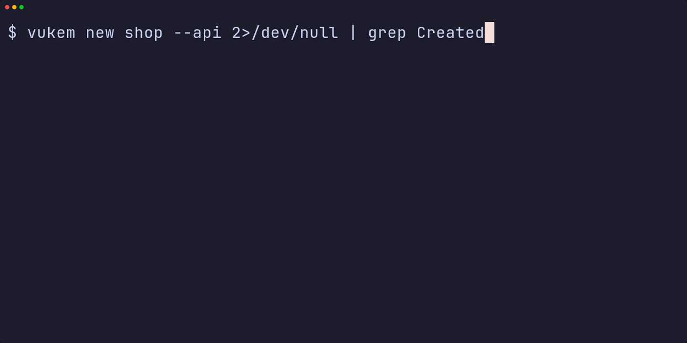
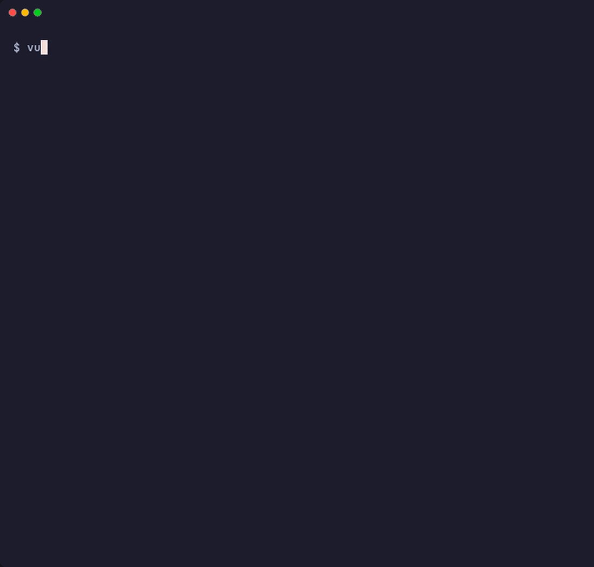

<p align="center">
  <a href="https://vukem.dev"></a>
</p>

<p align="center">
  <a href="https://github.com/AlexGalhardo/vukem/actions/workflows/ci.yml"></a>
  <a href="https://github.com/AlexGalhardo/vukem/actions/workflows/release.yml"></a>
  <a href="https://github.com/AlexGalhardo/vukem/releases"></a>
  <a href="https://pkg.go.dev/github.com/AlexGalhardo/vukem"></a>
  <a href="LICENSE"></a>
  <a href="https://scorecard.dev/viewer/?uri=github.com/AlexGalhardo/vukem"></a>
</p>

## Introduction

Vukem is a complete Model-View-Controller (MVC) web framework for Go built on `net/http` and the `standard library` to build APIs and FullStack Web Applications.

## Highlights

Six things that make Vukem different, each shown with the real `vukem` CLI.

### 1. A typed JSON API in one command

`vukem new shop --api` writes a working JSON-only API: API tokens, a posts resource, RFC 9457 problem+json errors, CORS, rate limits and tests. Typed handlers, OpenAPI 3.1 and a Scalar reference are opt-in. Migrate, seed and call it.



### 2. A full-stack HTMX app

Server-rendered `html/template` views, HTMX 4, Vite and Tailwind CSS v4, sessions, CSRF protection and a migration, from one command. Every route is named and listed by `vukem route:list`.



### 3. Inertia with React, Vue or Svelte

`vukem new app --inertia react` gives you Inertia pages, shared props, SSR and a typed client without a separate API layer.


### 4. Tested by default, secure by default

The framework ships with a large test suite, including one `TestSecurity_*` test for every secure default, and `vukemtest` gives your own app an in-process client with fluent assertions.


### 5. Migrations, seeders and factories

Generate a model with its migration and factory, add seeders (plain or app-aware with `--app`), then `vukem migrate` and `vukem db:seed`.


### 6. Generators that write code you own

Controllers, form requests, resources, jobs, mail and more. The generated files are ordinary Go that you read and edit; there is no hidden runtime.


Every command, flag and example is in the [CLI reference](https://vukem.dev/docs/cli/reference).

## Summary

| Area | What you get |
| --- | --- |
| **HTTP** | `net/http`-native router with named routes, resources, groups and host-only groups (`Group.Only`); middleware is `func(http.Handler) http.Handler`; request-log attributes (`web.AddLogAttrs`, matched route); HTTP/3 (`contrib/http3`). |
| **Validation** | Zod-style typed schemas (`z`) for every input, including files, exportable as JSON Schema, TypeScript and Zod. |
| **Database** | SQLite built in, PostgreSQL and MySQL/MariaDB driver modules, MongoDB, generic query builder, relations, encrypted columns, migrations, factories and seeders. |
| **Auth** | Sessions, API tokens, JWT with JWKS and refresh tokens, TOTP two-factor (`install:auth --2fa`), WebAuthn passkeys, social login (Google, GitHub, Apple, LinkedIn, X and any OIDC), email verification, password reset, gates and policies. |
| **APIs** | JSON resources, pagination, RFC 9457 errors (`ProblemDecorator`, `WithType`, `WithTitle`), JSON-RPC 2.0 with OpenRPC, rate limiting, idempotency keys, typed handlers, OpenAPI 3.1, a Scalar API reference and generated TypeScript and Go clients. |
| **GraphQL and gRPC** | A stdlib GraphQL server with subscriptions (`contrib/graphql`) and gRPC, gRPC-Web and Connect on connect-go (`contrib/grpc`). |
| **Real time** | Server-Sent Events, WebSockets and channel broadcasting with private and presence channels. |
| **Background work** | Typed queue jobs (sync, memory, database, Redis), queued mail and listeners, cron scheduler. |
| **Frontend** | HTMX, templ or Inertia (React, Vue, Svelte) starters with Vite and Tailwind CSS v4, SSR and a youch-style error page. |
| **Admin and devtools** | An HTMX admin panel generated from your models, with an audit log and opt-in hardening (`DenyStatus`, `TwoFactorRedirect`, `TrackIdle`), and a `/_vukem` dashboard for requests, queries (with N+1 detection), jobs, mail and logs. |
| **Billing and uploads** | Stripe subscriptions (`install:billing`), streaming, resumable (tus) and direct-to-S3 uploads with virus scanning. |
| **Bot protection** | Cloudflare Turnstile on form routes and a step-up challenge with a signed clearance cookie (`challenge`); Cloudflare helpers (`contrib/cloudflare`: real client IP, origin lock, Access, cache purge). |
| **SEO and analytics** | Sitemaps, `llms.txt` and `llms-full.txt` (`llmstxt`), static site generation (`ssg`), Umami and GA4 with Consent Mode v2, Search Console and Bing verification (`analytics`), the Bing Webmaster API (`bingwmt`) and IndexNow (`indexnow`). |
| **More** | Mail (SMTP, Resend, `MAIL_REPLY_TO`), cache with batched counters (`cache.Buffer`), feature flags, storage (local, S3), events, encryption, i18n, OpenTelemetry, Telegram logging, CSV and NDJSON export (`export.EncodeNDJSON`), image thumbnails and QR codes, SSRF-safe HTTP client with throttle, retry and circuit-breaker transports, signed URLs and tokens, and webhooks. |

## Why Vukem

- **Standard library first.** Handlers are plain `net/http`; any `http.Handler` works.
- **No magic.** No globals, no `init()` registration, no reflection-based dependency injection. Generators write code you own.
- **Typed end to end.** Inputs parse into Go types, outputs are checked, and the same types produce your OpenAPI and TypeScript.
- **Opt-in batteries.** Heavy drivers (PostgreSQL, MySQL, Redis, MongoDB, S3, WebSockets, OpenTelemetry) and integrations (GraphQL, gRPC, Stripe) are separate modules, so you only download what you use.
- **Secure by default.** CSRF, security headers, Argon2id, safe SQL, fail-closed authorization, mapped to the [OWASP Top 10:2025](docs/security.md).
- **Windows is first-class.** Pure Go, no C compiler, tested on Windows, Linux and macOS.

## Showcase

Four open-source reference apps are built with Vukem and run live. Each one is a complete product, not a demo page: read their code to see how the pieces fit together ([details](https://vukem.dev/docs/showcase)).

### Go Quiz

[](https://github.com/AlexGalhardo/vukem-golang-quiz-htmx)

A Go interview trainer with 130+ questions in English and Brazilian Portuguese, from very easy to very hard. You answer one question at a time, get an explanation of why each of the five alternatives is right or wrong, with sources, and track your accuracy per difficulty. There are no accounts: progress stays in your browser.

- **Stack**: HTMX 4, server-rendered templates, questions embedded as JSON, Tailwind CSS v4.
- **Shows**: i18n, dark mode, CSP nonces, rate limiting behind a proxy, Lighthouse 100.
- **Links**: [live](https://quiz.vukem.dev) · [source](https://github.com/AlexGalhardo/vukem-golang-quiz-htmx)

### Rifa

[](https://github.com/AlexGalhardo/vukem-rifa-vuejs)

A Brazilian raffle platform. Owners create raffles with 10 to 1000 numbers, generate a 10-minute payment link for each buyer, and get paid by PIX; the draw runs automatically at the end date or when every number is sold. Payments split 90% to the owner and 10% to the platform through a ledger with manual payouts.

- **Stack**: Inertia v3 + Vue, PostgreSQL, Tailwind CSS v4.
- **Shows**: email/password and Google login, PIX with AbacatePay and webhooks, scheduler and queue inside `serve`, a REST API with API keys and Scalar docs, JSON/CSV audit export, an OWASP Top 10 test suite.
- **Links**: [live](https://rifa.vukem.dev) · [source](https://github.com/AlexGalhardo/vukem-rifa-vuejs)

### Marketplace

[](https://github.com/AlexGalhardo/vukem-marketplace-reactjs)

A multi-seller marketplace inspired by the big Latin American e-commerce sites. Sellers open shops and list products with images; buyers search, fill a cart, calculate freight by CEP and pay by card or PIX, and sellers receive their share through Stripe Connect.

- **Stack**: Inertia v3 + React + Base UI, PostgreSQL, Redis, MongoDB, S3-compatible storage, Tailwind CSS v4.
- **Shows**: TOTP two-factor auth, Google login, Stripe Connect and PIX, ViaCEP, REST, GraphQL and gRPC on one domain model, queues and SSE, seller webhooks, OpenTelemetry and Telegram logging.
- **Links**: [live](https://marketplace.vukem.dev) · [source](https://github.com/AlexGalhardo/vukem-marketplace-reactjs)

### Vukem Tools

[](https://github.com/AlexGalhardo/vukem-tools)

A self-hosted file toolbox in a single Go binary: convert, compress and optimise images, video, audio and documents, download videos, turn pixel art into SVG, and use developer tools such as a JSON formatter, a text diff and CPF/CNPJ helpers. Long conversions run as queued jobs with live progress.

- **Stack**: Inertia v3 + React + Base UI, PostgreSQL, Tailwind CSS v4, external engines (ffmpeg, libvips, Ghostscript and others) driven as subprocesses.
- **Shows**: queue jobs with progress over Server-Sent Events, streaming uploads, accounts and per-user limits, a Telegram bot on the same API.
- **Links**: [live](https://tools.vukem.dev) · [source](https://github.com/AlexGalhardo/vukem-tools)

## Why MVC and not Hexagonal/Clean Architecture?

- This framework was inspired by the simplicity of well established frameworks like: Laravel, Ruby on Rails, AdonisJS, Django.
- Hexagonal and Clean Architecture are better developed without framework's attachment in Go ecosystem.

## Agentic development

Vukem's predictable structure and conventions (generators, typed schemas, named routes, no magic) make it a natural fit for AI coding agents like Claude Code, Cursor and GitHub Copilot. Install **Vukem Boost** in your project to supercharge your AI workflow:

```sh
vukem boost:install
```

Boost adds Vukem guidelines to `AGENTS.md`, framework skills to `.claude/skills/` and the `vukem-boost` MCP server to `.mcp.json` (plus `.cursor/` and `.vscode/` when present). The server gives your agent tools to inspect the running app: application info, routes, commands, the database schema, read-only SQL queries, absolute URLs for named routes and a documentation search.

## Stability

Vukem 1.x keeps the Go 1 compatibility promise: no breaking API changes until v2, deprecations kept for at least two minors, the two latest Go releases supported. Read the [stability policy](docs/stability.md) and the [upgrade guides](docs/upgrade/README.md).

## Contributing

Thank you for considering contributing to Vukem! Read the [contribution guide](.github/CONTRIBUTING.md) to get started.

## Code of conduct

To keep the community welcoming to everyone, please review and follow the [Code of Conduct](.github/CODE_OF_CONDUCT.md).

## Security vulnerabilities

If you discover a security vulnerability, please follow the [security policy](.github/SECURITY.md) instead of opening a public issue.

## License

Vukem is open-source software licensed under the [MIT license](LICENSE).
